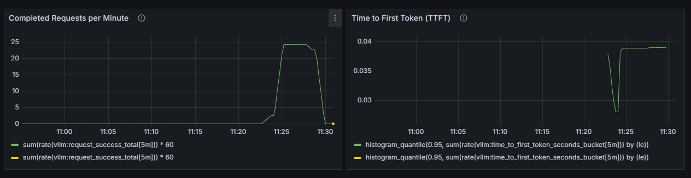

# 03 · Observability

Prometheus and Grafana running in the same namespace as the vLLM engines, watching what users actually feel: how long until the first token, and how many requests complete.



| File | Purpose |
| --- | --- |
| [`prometheus.yaml`](prometheus.yaml) | Prometheus scraping both vLLM engines (`team-serving`, `llama-serving`) every 15 s, 30-day retention on a PVC |
| [`grafana.yaml`](grafana.yaml) | Grafana with Prometheus provisioned as the data source, anonymous read-only viewers, admin password from a Secret, NodePort 30300 |
| [`dashboards/team-service-dashboard.json`](dashboards/team-service-dashboard.json) | The team service dashboard |
| [`alerts/ttft-p95-alert.json`](alerts/ttft-p95-alert.json) | Alert rule on TTFT p95 |
| [`slo/slo-targets.md`](slo/slo-targets.md) | Service indicators, targets and the measurements behind them |
| [`integration-note.md`](integration-note.md) | Go-live handover to the partner team: endpoint, model, SLOs, limits, on-call |

```bash
kubectl -n team apply -f prometheus.yaml -f grafana.yaml
kubectl -n team create configmap slo-dashboard --from-file=dashboards/team-service-dashboard.json
```

Prometheus uses the `Recreate` strategy on purpose. With one replica and a ReadWriteOnce volume, a rolling update would start the new pod before stopping the old one, and the new Prometheus would fail on the database lock.

## Dashboard panels

| Panel | Query |
| --- | --- |
| Traffic Over Time | `sum(rate(vllm:request_success_total[5m])) * 60` |
| Completed Requests per Minute | same, as a single stat |
| Time to First Token (TTFT) | `histogram_quantile(0.95, sum(rate(vllm:time_to_first_token_seconds_bucket[5m])) by (le))` |
| p95 TTFT gauge | same, on a 0 to 1 s scale |

## SLOs and alerting

| Indicator | Target | Measured at go-live |
| --- | --- | --- |
| TTFT p95 | < 0.120 s | ≈ 0.039 s |
| Completed requests | ≥ 20 req/min under active traffic | ≈ 24.3 req/min |

The 0.12 s target is the internal alert threshold; the commitment published to the partner team in the [integration note](integration-note.md) was a looser 350 ms. The alert fires when TTFT p95 stays above 0.12 s for 1 minute, and its message points the on-call engineer to GPU memory, concurrency and burst rate.

---
Some manifests came from SDA bootcamp templates; the dashboard, SLO targets and alert rule are my work for the team service.
