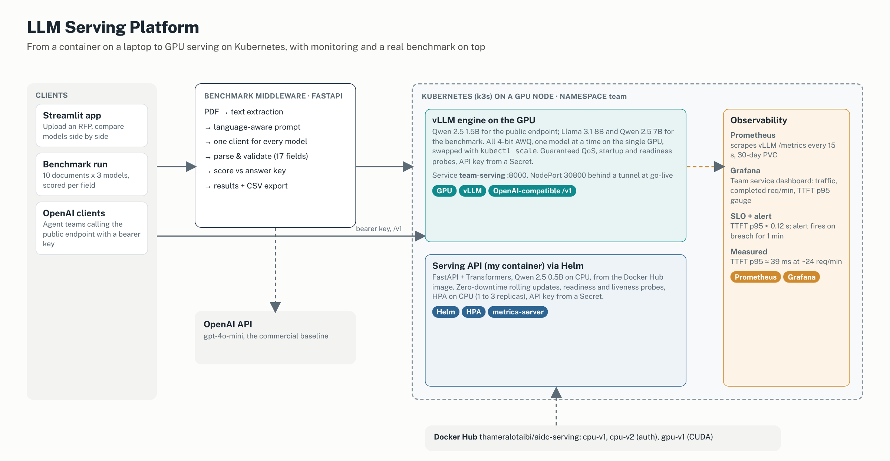
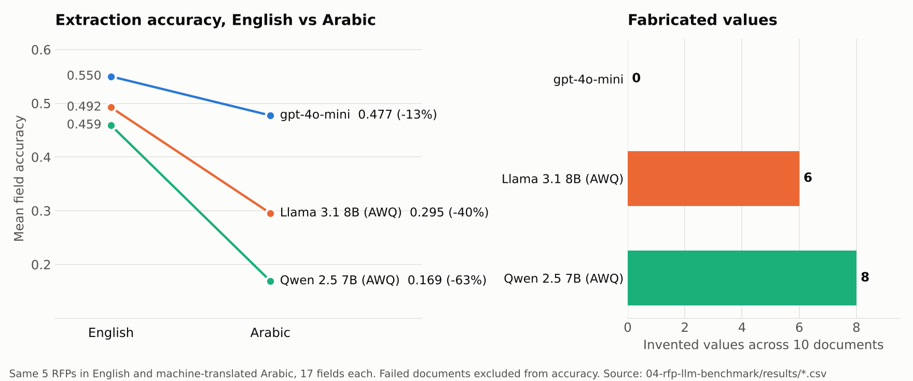

# LLM Serving Platform

End-to-end LLM infrastructure, built during the **Saudi Digital Academy AI Data Center Operations Bootcamp** (2026, 280 hours). It goes from wrapping a model in an OpenAI-compatible API and a Docker image, to running vLLM on a GPU Kubernetes cluster with Helm, autoscaling and Prometheus/Grafana SLO monitoring, and finally to using that stack to benchmark self-hosted LLMs against a commercial API on real tender documents in English and Arabic.

## What's inside

| Folder | What it shows | Highlights |
| --- | --- | --- |
| [**01-serving-api**](01-serving-api/) | FastAPI model service with an OpenAI-compatible `/v1` API, CPU and CUDA Docker images, Compose, bearer-token auth | Image cut from 3.49 GB to 1.61 GB (−54%); 16.7× faster on a T4 GPU than on CPU |
| [**02-kubernetes**](02-kubernetes/) | Helm chart with zero-downtime rolling updates, probes and HPA; vLLM on a GPU node with Guaranteed QoS | Showed why CPU-based autoscaling fails for a GPU engine (GPU 94%, CPU 27%); queue depth is the right signal |
| [**03-observability**](03-observability/) | Prometheus, Grafana dashboard, SLO targets, TTFT alert, go-live handover | TTFT p95 ≈ 39 ms at ≈ 24 requests/min against a 120 ms target |
| [**04-rfp-llm-benchmark**](04-rfp-llm-benchmark/) | Team capstone: Llama 3.1 8B and Qwen 2.5 7B (AWQ, vLLM on Kubernetes) vs gpt-4o-mini, extracting 17 fields from RFPs | gpt-4o-mini invented 0 values; the self-hosted models invented 6 and 8. Arabic accuracy dropped 13% / 40% / 63% |

## Benchmark results

- **English:** the three models scored close together, within the measured run-to-run noise.
- **Arabic:** this is where they separated. gpt-4o-mini lost 13% of its English score, Llama 40% and Qwen 63%.
- **Failure mode:** gpt-4o-mini answers "not stated" when unsure, while the self-hosted models invent a value. For a client reading an extracted RFP, a made-up deadline is worse than a blank field.

Method, measurement noise and limitations are in the [benchmark README](04-rfp-llm-benchmark/README.md).

## Tech stack

**Serving:** FastAPI, Transformers, PyTorch, vLLM, AWQ quantisation, OpenAI-compatible API
**Containers:** Docker (slim CPU and CUDA images), Docker Compose, Docker Hub
**Orchestration:** Kubernetes (kind, k3s), Helm, HPA, metrics-server, NVIDIA device plugin
**Observability:** Prometheus, Grafana, SLOs, alerting
**Application:** Python, Streamlit, PyMuPDF text extraction, field-level scoring against answer keys

## Credits

The capstone was a team effort with [@Abdu1l-0](https://github.com/Abdu1l-0), [@3wex](https://github.com/3wex) and [@MohnadBabgi](https://github.com/MohnadBabgi). Some manifests and the API schema started from the bootcamp's course materials.

Not included: API keys and `.env` files, kubeconfigs, the client's RFP PDFs, and raw model outputs.
